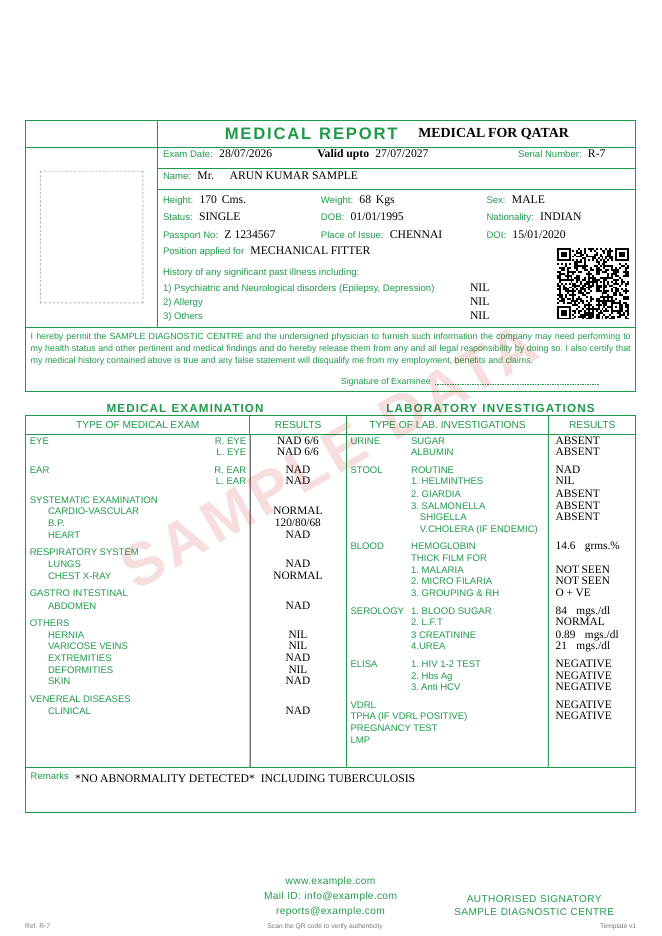

# Medical Reporting Platform

A production-oriented web application for creating pre-employment medical examination reports, modelled on the
supplied reference report (a scanned "MEDICAL REPORT — MEDICAL FOR QATAR"; not stored in the repository because it contains real personal data).

Authorised staff sign in, upload a passport, review the OCR-extracted identity, enter the examination and laboratory
results, and issue a single-page A4 PDF. Each issued PDF carries a unique QR code that opens a public verification page.
Data and files live in Supabase (PostgreSQL + private Storage), with row-level security isolating each organisation.



---

## Contents

1. [Features](#features)
2. [How the reference report was mapped](#how-the-reference-report-was-mapped)
3. [Architecture](#architecture)
4. [Local development](#local-development)
5. [Database migrations](#database-migrations)
6. [Passport OCR configuration](#passport-ocr-configuration)
7. [Testing](#testing)
8. [Deployment](#deployment)
9. [Backups, retention and operations](#backups-retention-and-operations)
10. [Security model](#security-model)
11. [Troubleshooting](#troubleshooting)
12. [Known limitations and assumptions](#known-limitations-and-assumptions)

---

## Features

| Area | What is implemented |
|---|---|
| Authentication | Supabase Auth (email + password). Sign-up is disabled; administrators invite users. Login is rate-limited and returns the same error for unknown accounts and wrong passwords. |
| Roles | Super Administrator, Organisation Administrator, Medical Officer, Reporting Staff, Read-only Auditor. The permission matrix is in `src/lib/auth/roles.ts` and is mirrored by RLS. |
| Dashboard | Totals, created today, drafts, pending review and completed counts, all calculated from database records. Also recent reports, status filters, search, and a "Create new report" button. |
| Report list | Server-side search (serial, name, passport number, position), status and date filters, pagination, masked passport numbers, QR status, and preview/edit/download/archive actions. |
| Report editor | Six-step wizard: report information → passport upload → identity review → medical history/examination/laboratory → review (live preview and checklist) → save/submit/issue. Uses React Hook Form with a Zod schema derived from the template. Drafts use optimistic concurrency. |
| Passport OCR | Provider abstraction (`PassportOcrProvider`, `extractPassportData`, `validateExtraction`, `mapPassportFieldsToReport`). Real provider: **Azure AI Document Intelligence** (prebuilt-idDocument). A clearly labelled **mock** provider is used for development. MRZ parsing validates check digits, and printed values are cross-checked against the MRZ. Uncertain values are flagged. Supports retry, cancellation and manual entry, and requires explicit confirmation before anything is saved. |
| Templates | Versioned field configuration, letterhead (blank / text / image) and layout (QR position, signature/seal positions, spacing, fonts, colour). Safety invariants cannot be removed. A template version used by any report is frozen in the database. |
| PDF | Deterministic HTML/CSS template rendered by Chromium (Playwright) on the server. Output is validated as A4 portrait and a single page. Overflow is detected, never clipped; a controlled continuation-page layout is offered instead. |
| QR verification | A 256-bit HMAC-derived token per issued report; only its SHA-256 hash is stored. `/verify/[token]` shows status, reference, organisation and dates only, and is rate-limited. States: valid, expired, revoked, superseded, not found. |
| Storage | Private buckets `passport-documents`, `generated-reports` and `organisation-assets`, with organisation-scoped paths and storage RLS. Files are opened through 60-second signed URLs. PDFs are versioned with content hashes. |
| Corrections | Issued reports are immutable (enforced by a trigger). Corrections create a revision with the same serial number; issuing it marks the original as superseded. Revocation records a reason. |
| Audit | An append-only `audit_logs` table. Status changes are logged by a database trigger; the application logs uploads, OCR, reviews, downloads, prints and admin changes. Metadata is allow-listed, so no medical or identity data is logged. |
| Admin | Organisation settings (letterhead details, serial format, validity rule, time zone, independent review, retention, optional signature/seal images), template manager with sample preview, user management (invite, change role, deactivate), audit log viewer, and super-admin organisation management. |

## How the reference report was mapped

The reference is a colour scan, and colour cannot be recovered from extracted PDF text, so it was mapped by visual
inspection. The full generated table is in **[`docs/field-mapping.md`](docs/field-mapping.md)**.

- **Green (pre-printed):** labels, headings, column titles, the declaration wording (with the centre's name substituted), "Signature of Examinee", the "AUTHORISED SIGNATORY" caption and the footer contact lines. These are template text and organisation settings, editable by administrators and versioned.
- **Black (typed per report):** destination ("MEDICAL FOR QATAR"), exam date, validity date, serial number, title and name, every identity value, the history answers, every examination and laboratory result, units beside values, and remarks. These are form inputs (or server-generated values for the serial and validity date). **No result is ever pre-filled.** Suggestions such as NAD, NIL, ABSENT and NEGATIVE are offered, but nothing is selected by default.
- **Purple (rubber stamps):** "ORIGINAL", the centre seal, the "FIT" stamp and the doctor's stamp are **not reproduced**. The footer reserves blank space for physical stamps and signatures. Approved signature/seal images can be enabled per organisation; this is off by default.
- **Layout:** a blank letterhead band (38 mm by default, configurable), then the identity box with a photo area and the QR code beside the details (as on the reference; a footer position is also available), the declaration, the two-column examination and laboratory tables, remarks, and a footer with seal, contact lines and signature areas.
- **Conditional rules:** TPHA is required when VDRL is positive or reactive. The pregnancy test and LMP are shown (and the pregnancy test required) only for female examinees. V.Cholera is optional ("if endemic").
- **Validity:** "Valid upto" is calculated from a configurable rule. The default is 1 year minus one day, which matches the reference (28/07/2026 → 27/07/2027).

## Architecture

```
src/
  app/
    (auth)/login            sign-in (server action, rate limited)
    (app)/…                 authenticated app: dashboard, reports, editor, settings, users, audit, account
    verify/[token]          public QR verification page (minimal data)
    api/…                   uploads + OCR, preview HTML, signed-URL redirects, health
    auth/confirm            invitation / recovery link handler
  lib/
    template/               template schema, default template, invariants, data validation, Zod form schema
    passport/               MRZ parser, OCR providers (azure, mock), extraction validation & field mapping, service
    pdf/                    deterministic HTML renderer + Playwright PDF generation and A4/overflow validation
    qr/                     verification tokens (HMAC + SHA-256) and QR rendering
    reports/                report service (drafts, save, review, issue, regenerate, revise, revoke), queries
    auth/                   role/permission matrix, session + authorisation helpers
    security/               upload validation (size, MIME, magic bytes), rate limiter
    supabase/               server/browser/admin clients, row types
supabase/
  migrations/               schema, functions/triggers, RLS, storage buckets & policies
  config.toml, templates/   Supabase CLI config, auth email templates
tests/
  unit/  pdf/  db/  e2e/    see "Testing"
```

Key design decisions:

- **Serial numbers** come from `next_report_serial()`, which uses `INSERT … ON CONFLICT DO UPDATE` on a per-organisation counter row. This is safe under concurrency (tested with 40 parallel inserts). Client-supplied serials are ignored.
- **Section data** is stored as JSONB (`report_details`, `examinee_details`, `medical_history`, `medical_examination`, `laboratory_results`) and validated against the template on every save. Frequently queried values (name, passport number, normalised passport number, position, nationality) are kept in sync by a trigger and indexed.
- **Issuing** is idempotent. A claim column prevents double issuing; a retry after a network failure returns the already-issued report.
- **Reproducibility:** at issue, the organisation details, template and asset paths are frozen in `issued_snapshot`. Assets are content-addressed and never overwritten, so a regenerated PDF matches the issued content exactly.
- **Verification tokens** are `HMAC-SHA256(VERIFICATION_TOKEN_SECRET, reportId + nonce)`. The server can re-derive the token for regeneration, so printed QR codes stay valid, but the database stores only `SHA-256(token)`.

## Local development

Requirements: Node.js ≥ 20.11 (22 recommended), npm, and either the Supabase CLI with Docker or a Supabase cloud project.

```bash
npm install
cp .env.example .env.local      # then fill in values (see below)
```

### Option A — Supabase CLI (Docker)

```bash
npx supabase start               # starts Postgres, Auth, Storage, Studio; applies supabase/migrations
npx supabase status              # copy API URL, anon key and service_role key into .env.local
npm run dev                      # http://localhost:3000
```

### Option B — Supabase cloud project

1. Create a project and copy the API URL, anon key and service-role key into `.env.local`.
2. Apply the migrations: `npx supabase link --project-ref <ref>` then `npx supabase db push`.
3. **Auth settings:** disable sign-ups, set the Site URL to your app URL, and add `<app>/auth/confirm` to the redirect URLs.
4. **Email templates:** use `supabase/templates/invite.html` and `recovery.html`. The links must point to `/auth/confirm?token_hash=…`.

### Create the first organisation and administrator

```bash
NEXT_PUBLIC_SUPABASE_URL=… SUPABASE_SERVICE_ROLE_KEY=… \
npm run bootstrap -- --org "Example Medical Centre" --admin-email admin@example.com \
  --admin-name "Clinic Admin" --admin-password 'a-long-unique-password'
# optional: --super-admin-email ops@example.com --super-admin-password '…'
```

Without `--admin-password`, an invitation email is sent instead. Then sign in and complete **Organisation Settings**:
declaration name, registration number, footer lines, serial prefix and validity rule.

### Environment variables

See `.env.example`, which contains placeholders only. Never commit real values.

| Variable | Scope | Purpose |
|---|---|---|
| `NEXT_PUBLIC_APP_URL` | public | Base URL used inside QR codes (`/verify/<token>`) |
| `NEXT_PUBLIC_SUPABASE_URL`, `NEXT_PUBLIC_SUPABASE_ANON_KEY` | public | Supabase API |
| `SUPABASE_SERVICE_ROLE_KEY` | **server only** | User invitation and bootstrap only, never sent to the browser |
| `VERIFICATION_TOKEN_SECRET` | **server only** | ≥ 32 random characters; rotating it invalidates every issued QR code |
| `OCR_PROVIDER` | server | `azure` or `mock` |
| `AZURE_DOCUMENT_INTELLIGENCE_*` | **server only** | Endpoint, key and API version (default `2024-11-30`) |
| `OCR_MOCK_MODE` | server | `specimen` (default) or `fail` (to test the failure path) |
| `ALLOW_MOCK_OCR_IN_PRODUCTION` | server | Must be `true` for the mock to work under `NODE_ENV=production` (E2E only) |
| `PASSPORT_MAX_FILE_MB` | server | Upload size limit (default 10) |
| `PDF_CHROMIUM_EXECUTABLE_PATH` | server | Optional custom Chromium binary |
| `RATE_LIMIT_VERIFY_PER_MINUTE`, `RATE_LIMIT_UPLOAD_PER_MINUTE` | server | Per-IP/user limits |

## Database migrations

Migrations are plain SQL in `supabase/migrations`, applied in filename order:

| File | Contents |
|---|---|
| `…0100_schema.sql` | Enums, tables, constraints and indexes |
| `…0200_functions.sql` | Identity helpers, serial numbers, workflow/immutability triggers, template freeze, audit, `verify_report()`, retention helper |
| `…0300_rls.sql` | RLS on every table, the metadata-only `report_registry` view, grants |
| `…0400_storage.sql` | Private buckets and organisation-scoped storage policies |

The same files are used everywhere: `supabase db reset` (local), `supabase db push` (staging/production), and the test
harnesses. To change the schema, add a new timestamped migration; never edit one that has already been applied to a
shared environment.

## Passport OCR configuration

**Azure AI Document Intelligence (real provider):**

1. Create a Document Intelligence resource (S0 tier recommended) in a region that meets your data-residency requirements.
2. Set `OCR_PROVIDER=azure`, `AZURE_DOCUMENT_INTELLIGENCE_ENDPOINT` and `AZURE_DOCUMENT_INTELLIGENCE_KEY`.
3. The app sends the file server-side to the `prebuilt-idDocument` model and polls for the result.

**How extraction works:**

- The MRZ is parsed and its check digits verified. Printed (VIZ) values are cross-checked against the MRZ, and any disagreement is flagged rather than silently resolved.
- Values below 85% confidence, MRZ-only names, composed full names and place of issue are always marked for review.
- Missing fields stay empty, and the issuing authority is never copied into "place of issue".
- The passport number and name are stored exactly as confirmed. A normalised passport number is derived separately for search.
- The extracted data and per-field confidence are stored on the `passport_documents` row. Nothing reaches the report until the user ticks the attestation and confirms.

**Adding another provider:** implement `PassportOcrProvider.extract()` returning `RawProviderResult`, then add it to
`getPassportOcrProvider()`. The shared `validateExtraction()` logic applies automatically.

The **mock provider** never reads the document. It returns an obviously fictitious "SPECIMEN / MOCK DATA" identity,
and the UI shows a "Development mock OCR" warning. It is refused in production unless explicitly allowed.

## Testing

| Command | What it covers | Needs |
|---|---|---|
| `npm test` | Unit: MRZ (ICAO specimen, check digits, OCR noise), extraction/merging/flags, Azure/mock providers, template invariants, data validation (required/conditional/format), upload validation, permissions, tokens, rate limiter, audit metadata, validity rule | Node |
| `npm run test:pdf` | Real Chromium render: single A4 page, deterministic HTML, **QR decodes** to the URL, letterhead band blank, signature/seal areas blank, section order, every field printed, maximum-length values fit, overflow refused with continuation offered, HTML injection escaped | Chromium; `pdftoppm` (poppler-utils) for raster checks |
| `npm run test:db` | Applies all migrations to a throwaway PostgreSQL and tests RLS tenant isolation, role restrictions, auditor metadata-only view, workflow transitions, immutability, revisions/supersede, **concurrent serial numbers**, public verification minimal data and states, audit append-only, storage policies, template freeze | PostgreSQL server binaries (or `TEST_DATABASE_URL`) |
| `npm run test:e2e` | Full browser workflow on a **local Supabase-compatible stack** (PostgreSQL + official GoTrue and PostgREST binaries + a storage shim enforcing the same storage RLS): sign in → create → passport upload (image and PDF) → OCR → review/correct → medical sections → submit → medical officer issues → PDF downloaded and validated (A4, 1 page, QR decoded from the PDF) → public verification (no personal data) → revision supersedes original → revoke → cross-organisation URL tampering returns 404, auditor restrictions, admin pages | As above + internet access to download the GoTrue/PostgREST release binaries on first run |
| `npm run typecheck`, `npm run lint` | Static checks | — |

To run the E2E suite against a deployed environment instead, set `E2E_BASE_URL` and provide
`tests/.artifacts/e2e-stack.json` with seeded users (same shape as the one the local stack writes).

`npm run render:sample` writes a sample PDF (clearly watermarked "SAMPLE DATA") to `tests/.artifacts/` for visual comparison with the reference.

## Deployment

Any Node.js host that can run Chromium works: a container platform (Fly.io, Render, Railway, ECS, Cloud Run) or a VM.
Serverless platforms with strict size limits need a slim Chromium build (set `PDF_CHROMIUM_EXECUTABLE_PATH`).

```bash
docker build \
  --build-arg NEXT_PUBLIC_APP_URL=https://reports.example.com \
  --build-arg NEXT_PUBLIC_SUPABASE_URL=https://xyz.supabase.co \
  --build-arg NEXT_PUBLIC_SUPABASE_ANON_KEY=… -t medical-reporting .
docker run -p 3000:3000 --env-file production.env medical-reporting
```

Checklist:

- [ ] Migrations applied with `supabase db push`; sign-ups disabled; email templates and redirect URLs configured.
- [ ] Secrets (`SUPABASE_SERVICE_ROLE_KEY`, `VERIFICATION_TOKEN_SECRET`, OCR keys) stored in the platform's secret manager, never in the image.
- [ ] `NEXT_PUBLIC_APP_URL` set to the final production domain *before* issuing reports, because it is encoded in every QR code.
- [ ] HTTPS enforced (HSTS headers are sent by the app).
- [ ] For more than one app instance, replace the in-memory rate limiter (`src/lib/security/rate-limit.ts`) with Redis/Upstash.
- [ ] `fonts-liberation` installed on the host; the Dockerfile does this. The template relies on these Arial/Times-metric fonts.
- [ ] A daily `npm run purge:passports` job scheduled if a retention period is configured.

## Backups, retention and operations

- **Database:** enable Supabase point-in-time recovery (Pro plan and above) or schedule `supabase db dump --data-only` / `pg_dump` to encrypted off-site storage. Test restores regularly.
- **Storage:** Storage objects are *not* included in database backups. Mirror the three buckets (for example `rclone` against the S3-compatible endpoint) to a separate encrypted bucket on a schedule. Generated PDFs are immutable and versioned, so incremental copies are sufficient.
- **Retention:** set `passport_retention_days` per organisation. `npm run purge:passports` deletes expired passport files and clears extracted identity data, keeps metadata, and writes an audit event. Issued reports and their PDFs are never deleted by the application; archiving only hides them from listings.
- **Key rotation:** rotating `VERIFICATION_TOKEN_SECRET` invalidates every QR code ever issued, so treat it as permanent and store it in two secure places. Supabase JWT keys and OCR keys can be rotated normally.
- **Monitoring:** `/api/health` for uptime checks. Application logs contain only error class names, never payloads or personal data.

## Security model

- **Tenant isolation:** every sensitive table has RLS keyed on `current_org_id()`, derived from the signed-in user's active profile. Changing a URL, UUID or storage path returns "not found".
- **Defence in depth:** server actions and API routes check permissions first (`authorize()`), then run as the user so RLS applies again. The service-role client is used only for inviting users and bootstrap.
- **Data minimisation:** auditors use a metadata-only view with masked passport numbers. Super administrators have no access to medical records. The public verification RPC returns reference, organisation, dates and status only.
- **Workflow integrity:** database triggers enforce allowed status transitions, approver roles, and immutability of issued reports and used template versions. Audit logs cannot be updated or deleted.
- **Uploads:** size limits, MIME allow-list, magic-byte detection, declared-vs-actual type check, sanitised file names, private storage, and short-lived signed URLs.
- **Output safety:** all report values are HTML-escaped. The PDF renderer runs with JavaScript disabled and every network request blocked. Previews are served with a restrictive CSP inside a sandboxed iframe.
- **Error handling:** errors shown to users are generic or allow-listed messages; internal details are never returned.
- **Compliance:** medical data and passport copies are sensitive personal data. Each organisation must define retention, access-review and breach procedures for its jurisdiction (for example DPDP Act 2023 in India, GDPR, or local medical-records law) and choose Supabase and OCR regions accordingly.

## Troubleshooting

| Symptom | Fix |
|---|---|
| "Invalid server environment configuration: X" | Variable `X` is missing or invalid; compare with `.env.example`. `VERIFICATION_TOKEN_SECRET` needs ≥ 32 characters. |
| Signed in but redirected back with "Account not active" | The profile has no organisation or is inactive. Invite the user from User Management or run `npm run bootstrap`. |
| "Mock OCR is disabled in production" | Configure `OCR_PROVIDER=azure`, or for a test deployment set `ALLOW_MOCK_OCR_IN_PRODUCTION=true`. |
| OCR always fails with HTTP 401/404 | Check the Azure endpoint (resource URL, no path) and key. The model `prebuilt-idDocument` must exist in your API version. |
| "The report content does not fit on a single A4 page" | Shorten the longest values (usually Remarks), or use "Issue with continuation page". |
| PDF generation fails with "Executable doesn't exist" | Install Chromium (`npx playwright-core install chromium`) or set `PDF_CHROMIUM_EXECUTABLE_PATH`. |
| Text looks different from the preview | Install `fonts-liberation` on the server. |
| QR codes point to `localhost` | `NEXT_PUBLIC_APP_URL` was wrong at build time. Rebuild with the production URL, then regenerate affected PDFs. Existing tokens remain valid. |
| Invitation link says "link=invalid" | Update the Supabase email templates to the `token_hash` links in `supabase/templates/`. |
| `npm run test:db` cannot find PostgreSQL | Install the PostgreSQL server package, or point `TEST_DATABASE_URL` at a disposable database. |

## Known limitations and assumptions

- **Reference interpretation:** labels were transcribed from the scan. Some were partly covered by stamps ("2) Allergy" and "3) Others"); they were read from context and can be corrected in the template manager. The declaration names "PEOPLE DIAGNOSTIC CENTRE" while the letterhead says "PEOPLE MEDICAL CENTRE", so the declaration name is a separate organisation setting.
- **Stool line items:** on the reference, SHIGELLA and V.CHOLERA (IF ENDEMIC) appear to share one result line. They are modelled as two separate fields (V.Cholera optional).
- **No automatic fitness verdict:** the "FIT" stamp is physical, and the application never infers fitness or other conclusions.
- **QR position:** the brief mentions a footer QR, while the reference prints it beside the identity details. The reference position is the default and the footer is selectable per template.
- **Field length limits** were sized so that maximum-length uppercase values fit the printed cells. Unusually wide content is reported (overflow error) rather than clipped.
- **Untested here:** the Docker image (container registries were unreachable in the build environment) and the real Azure OCR service (no credentials). The Azure integration is covered by contract tests with mocked HTTP responses; run it against your own resource before go-live.
- **Rate limiting** is in-memory per instance.
